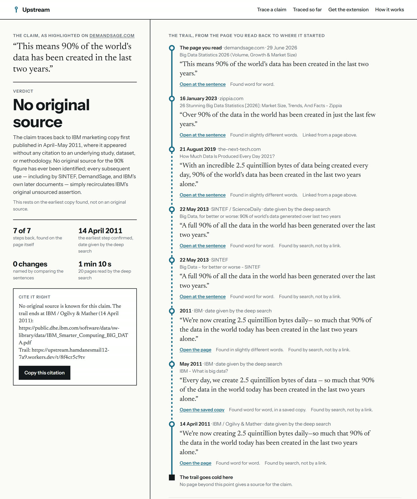

# Upstream

**Where did that number come from?** Highlight a claim on any page, and Upstream follows it back, one source at a time, to where it first appeared. Every step is a real page, read again, with its date and its exact wording. Where the wording changed on the way, it says what changed. When there is no original source, it says that too.



Live: **https://upstream.hamdanesmail12-7a9.workers.dev**

Built for the TinyFish Student Bounty Drop 002 ("Source Hunter"). TinyFish does all the reading: Fetch reads every page, and a TinyResearch run searches wider when the links run out.

## Four real trails

Each of these was traced from a sentence on a real page.

| The claim, as a page states it | Verdict | What the trail shows |
|---|---|---|
| ["People spend nearly 90 percent of their time indoors"](https://upstream.hamdanesmail12-7a9.workers.dev/t/qg55tfayga) | Changed on the way | Seven steps. The measured figure, in a 2001 survey, is 87 percent. Upstream names the change: *rounded: 87% became 90 percent*. |
| ["90% of the world's data has been created in the last two years"](https://upstream.hamdanesmail12-7a9.workers.dev/t/8f4cr5c9tv) | No original source | Eight steps, back to an advertisement dated 14 April 2011. No study or dataset is behind it, and it has been repeated as current ever since. |
| [A famous line about insanity, credited to a physicist](https://upstream.hamdanesmail12-7a9.workers.dev/t/mwjdgwwmvk) | Said by someone else | Five steps. The earliest appearance is a 1981 newspaper article, which survives only as quoted by a later page. |
| ["It takes 21 days to build a habit and 90 days to make it permanent"](https://upstream.hamdanesmail12-7a9.workers.dev/t/amhejbhyyc) | No original source | No source at all was found for the 90 days. The 21 days come from a 1960 book that said "a minimum of about 21 days", and Upstream names what was lost: *careful words dropped: "usually", "a minimum of", "about"*. |

## Try it

**Without installing anything.** Open the [site](https://upstream.hamdanesmail12-7a9.workers.dev), paste the address of a page and a sentence from it, and press "Trace it upstream". The first steps appear within seconds; the full trail usually takes 4 to 6 minutes, and the page updates by itself while you watch.

**With the Chrome extension.**

1. Download [upstream-extension.zip](https://upstream.hamdanesmail12-7a9.workers.dev/assets/upstream-extension.zip) and unzip it.
2. Open `chrome://extensions`, switch on "Developer mode", choose "Load unpacked" and pick the unzipped folder.
3. On any page, highlight a sentence, right-click, and choose **Trace upstream**. The trail opens in a panel beside the page. When it is done, the sentence on the page is underlined with the verdict next to it.

The extension holds no key and needs no account. It reads the page only at the moment you choose "Trace upstream", and sends three things: the sentence, the page's address, and the links in that paragraph.

## How a trace works

1. **Read the page.** TinyFish Fetch reads the page; Upstream finds the highlighted sentence on it.
2. **Follow the links.** It reads the pages that page links to, up to ten in one Fetch call, and looks for the same claim. A page that states it becomes the next step. This repeats up to five steps deep and takes seconds.
3. **Search wider.** A TinyResearch run looks for older sources that no link leads to. While it runs, the trail page says how many pages it has read.
4. **Read every step again.** The research run only proposes. Upstream opens each page it names and looks for the sentence. If the live page no longer holds it, Upstream tries the copy the Internet Archive saved nearest that date. A source that exists only in print is credited to the page that quotes it word for word.
5. **Compare and decide.** The earliest confirmed sentence is compared with the highlighted one, and the changes are named by code: a figure rounded, a figure changed, a careful word dropped, a year dropped.

What a trail shows, and what each mark means:

- A **solid line** between two steps: the newer page really links to the older one. A **dashed line**: the older one was found by search.
- **Found word for word**, **found in slightly different words**, **not found on this page**, **could not be read**, **not readable online**: every step says which.
- A date says where it came from when it is not the page's own: the Internet Archive's first saved copy, or the research run.
- "Open at the sentence" opens the source scrolled to the sentence, highlighted by the browser.
- "Cite it right" copies a citation that points at where the claim came from.

## The six verdicts

| Verdict | When |
|---|---|
| Matches the original | An original source was read and says the same. |
| Changed on the way | An original was read, and the claim differs from it in a figure or a careful word. |
| Out of date | The original is five or more years old and the claim is repeated as if it were current. |
| Said by someone else | A quotation whose earliest appearance has a different speaker or author. |
| No original source | The trail ends on a page that gives no source. |
| Not settled | The steps that matter could not be read, or the deep search did not run. |

Every verdict says whether it rests on an original source or only on the earliest copy found.

## What it does not do

- It does not decide whether a claim is true. It reports where the claim came from and what changed.
- It does not read pages behind a login or a paywall.
- It reads a page up to its first 120,000 characters.
- Inside a PDF the browser cannot jump to a sentence, so the link opens the file. PDF text often comes back with its lines broken in the middle of a sentence or a word. Upstream puts such a sentence back together where it can; where it cannot, the sentence is shown as found "in slightly different words" or not found.
- A source that exists only in print has no page to open. Its step opens the page that quotes it, at the quoted sentence, and the tally counts it apart from the steps found on their own pages.
- It trusts nothing the research run says about links or dates. Both are worked out again from the pages.

## Where TinyFish does the work

| TinyFish API | What Upstream uses it for |
|---|---|
| Fetch | Every page read: the highlighted page, the pages it links to (ten in one call), every step the research run proposes, and Internet Archive copies. It returns the text, the page's links, its date and its author. |
| TinyResearch | The wider search. The run is started, then read every 15 seconds; the pages it has read so far are shown while it works. Its report must end with the trail in a fixed shape, which Upstream reads and then checks page by page. |

## API

| Route | What it does |
|---|---|
| `POST /api/traces` | Start a trace: `{"page_url": "...", "text": "...", "near": ["..."]}`. Answers `202` with `id`, `url` and `api`, or `200` with `reused: true` when that sentence on that page already has a trail. |
| `GET /api/traces/:id` | The trail as JSON: status, progress, steps, changes, verdict, citation. |
| `GET /api/traces/:id/fragment` | The trail's markup alone. The extension's side panel shows this. |
| `GET /api/stats` | Trails, steps read, deep searches, spend. |

Refusals are plain: `400 text_too_short`, `400 text_too_long`, `400 bad_address`, `429 too_many_traces`, `429 daily_limit`, each with a `message`. The same list is on the site, at the foot of [How it works](https://upstream.hamdanesmail12-7a9.workers.dev/how#api).

## Limits and cost

- Following links is free. The deep search is free four times a day (two TinyResearch runs on each of my two accounts). After that a run costs $2 and is paid from a fixed reserve; when the free runs and the reserve are used, a trace still follows links and says that the deep search is back at midnight UTC. The first page says so too, before you start one.
- If TinyFish will not say how many runs were made today, no run is started. Not knowing is never a reason to spend.
- The same sentence on the same page is not traced twice. It opens the trail that exists. The one exception: a trail made on a day when no deep search was left is traced afresh when the sentence is traced again on a later day.
- One visitor can start 6 new traces an hour; all visitors together 40 a day. Upstream reads at most 500 pages a day.
- Only trails I choose are listed on the first page.

## Run it yourself

Node 24 or newer, and a TinyFish API key with Research enabled.

```bash
npm install
cp .dev.vars.example .dev.vars   # then put your key in it
npm run migrate:local
npm run dev
```

```bash
npm run check       # type check, 213 tests, and a dry-run deploy
npm run extension   # copy the stylesheet into the extension and write the zip
```

The tests never touch the network: TinyFish and the Internet Archive are replaced by stand-ins. To deploy, see [docs/runbook.md](docs/runbook.md).

## Where things are

| Path | What is there |
|---|---|
| `src/core/` | The parts with no network and no database: finding a claim on a page, comparing two sentences, naming changes, ordering a trail, the verdict, the citation. |
| `src/tinyfish/`, `src/archive.ts` | The TinyFish Fetch and Research clients, and the Internet Archive. |
| `src/trace/` | A trace from start to finish, as the small steps a Workflow runs. |
| `src/site/`, `src/app.tsx` | The pages and every route. |
| `extension/` | The Chrome extension. |
| `docs/` | The [design](docs/specs/2026-11-11-upstream-design.md), the [build plan](docs/plans/2026-11-11-upstream-build.md), the [build log](docs/build-log.md) and the [runbook](docs/runbook.md). |

Stack: TypeScript, Hono, Cloudflare Workers with D1 and Workflows, all on the free plan.

Built by [Hamdan Esmail](https://github.com/HamdanEsmail). MIT licence.
